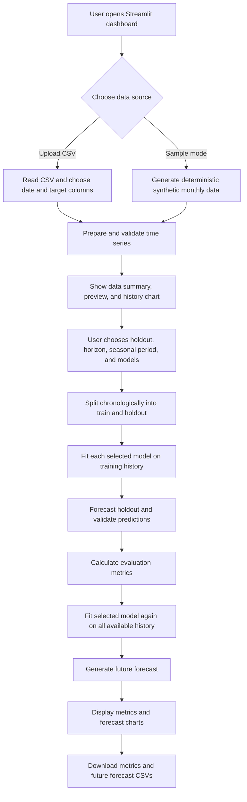

# Forecasting MLOps — AI Forecast Review

A modular Streamlit dashboard for comparing time-series forecasting models, reviewing chronological holdout metrics, plotting forecasts, and exporting results. GitHub Actions validates code and tests on pull requests and pushes, then builds a Docker image in CI.

## Live dashboard

**[Open the live forecasting dashboard](https://akankshab123-forecasting-app-cd6xcn.streamlit.app/)**

## Features

- Upload a CSV or try deterministic synthetic monthly sample data.
- Select date and target columns; configure holdout length, forecast horizon, and seasonal period.
- Compare Naive, ARIMA, SARIMA, SARIMAX, Prophet, and optional CNN models.
- Review MAE, RMSE, WAPE, and sMAPE on a chronological holdout.
- Plot history, holdout predictions, and future forecasts; download CSV outputs.
- Automated CI for Python 3.11/3.12, unit tests, Streamlit startup smoke test, and Docker image build.

## System design

The application is organized into three main layers: the Streamlit presentation layer, data preparation, and the forecasting/evaluation engine. This separation keeps UI code distinct from reusable data and model logic.



### Component responsibilities

| Component | Responsibility |
|---|---|
| `app.py` | Streamlit controls, data-source selection, charts, orchestration, error display, and CSV downloads. |
| `src/forecasting/data.py` | Builds sample data and converts a DataFrame into a validated, chronological time series. |
| `src/forecasting/engine.py` | Implements model forecasting functions and computes evaluation metrics independently of Streamlit. |
| `tests/` | Unit tests for data preparation and metric calculations. |
| `.github/workflows/ci.yml` | Runs validation and tests on supported Python versions, checks Streamlit startup, and builds the Docker image. |
| `EDA/` | Legacy exploratory notebooks kept separate from the app runtime. |

### Runtime flow

1. **Input:** The user uploads a CSV or selects the built-in synthetic sample. Uploaded data must contain a date/time column and at least one numeric target column.
2. **Preparation:** Dates and target values are parsed, invalid rows are dropped, observations are sorted, and duplicate timestamps keep the last row. If pandas can infer a regular frequency, missing periods are reindexed and interpolated.
3. **Review:** The dashboard shows the number of observations, start/end dates, a recent data preview, and the historical target chart.
4. **Configuration:** The user chooses the holdout size, future horizon, seasonal period, and models to run.
5. **Evaluation:** The most recent observations form a contiguous holdout. Each selected model is fitted using only the earlier training segment and predicts the holdout.
6. **Future forecasting:** For each model that completes the holdout step successfully, the app fits that model again on the complete available series and forecasts the requested future horizon.
7. **Results:** The app displays metrics, overlays actual values with holdout predictions, plots future forecasts, and offers CSV downloads.

## Step-by-step evaluation logic

The dashboard uses a **single chronological holdout split**, not a randomized train/test split. This preserves time order and makes the evaluation more representative of forecasting future observations.

### 1. Validate and prepare the series

The selected date column is parsed as datetime and the target column is converted to numeric values. Rows with invalid dates or targets are removed. Data is sorted by date and duplicate dates retain their last row. When a regular frequency can be inferred, the series is aligned to that frequency and missing values are interpolated.

The app requires at least `max(12, holdout + 6)` prepared observations. The forecasting engine also requires at least three training observations.

### 2. Create the chronological holdout

For a prepared series with `N` observations and holdout length `H`:

- **Training set:** all observations before the final `H` rows.
- **Holdout set:** the final `H` observations, kept in their original chronological order.

Conceptually:

```text
Past observations                         Most recent observations
|------------- training -----------------|------ holdout ------|
                                         <--- H observations --->
```

The selected models are fitted on the training set only for this backtest. The holdout values are reserved for comparison with the predictions. Do not shuffle time-series observations.

### 3. Fit the selected forecasting candidates

| Model | Current implementation |
|---|---|
| **Naive** | Repeats the last training value for every forecast step; a simple baseline that other models should aim to improve on. |
| **ARIMA** | Statsmodels ARIMA with fixed order `(1, 1, 1)`. |
| **SARIMA** | Seasonal statsmodels SARIMAX implementation with non-seasonal order `(1, 1, 1)` and seasonal order `(1, 1, 0, period)`. The selected period is bounded based on training history. |
| **SARIMAX** | Statsmodels SARIMAX with order `(1, 1, 1)` and seasonal order `(1, 1, 0, period)`; no external regressors are supplied. |
| **Prophet** | Prophet trend model with yearly seasonality set to automatic and weekly/daily seasonality disabled. Prophet must be installed, and the history must be suitable for fitting. |
| **CNN** | Optional TensorFlow 1D convolutional network. It scales the training values, builds sliding windows, trains for 20 epochs, then recursively predicts the requested steps. It needs substantially more history than the statistical baseline models. |

Model orders are fixed starter settings, not the result of hyperparameter optimization. Prophet and CNN are optional dependencies and may report an error if unavailable or if their input history is insufficient.

### 4. Validate model outputs

For the holdout forecast, the app checks that the prediction count matches the holdout length and that all predicted values are finite. A model that raises an exception or returns invalid output is recorded with an error status; the other selected models can still be evaluated.

### 5. Calculate evaluation metrics

For actual values (y_i), predictions \\(\hat{y}_i\\), and (n) holdout observations, the app calculates:

| Metric | Interpretation |
|---|---|
| **MAE** — Mean Absolute Error | \\(\frac{1}{n}\sum_i |y_i-\hat{y}_i|\\). Average absolute error in the target's original units; lower is better. |
| **RMSE** — Root Mean Squared Error | \\(\sqrt{\frac{1}{n}\sum_i(y_i-\hat{y}_i)^2}\\). Penalizes large errors more strongly; lower is better. |
| **WAPE (%)** — Weighted Absolute Percentage Error | \\(100\frac{\sum_i|y_i-\hat{y}_i|}{\sum_i|y_i|}\\). Percentage-style aggregate error; undefined when all actual values are zero. |
| **sMAPE (%)** — Symmetric Mean Absolute Percentage Error | Uses the symmetric absolute-error denominator \\( |y_i|+|\hat{y}_i| \\), with zero contribution when both are zero. Lower is generally better, but interpretation can be unstable near zero. |

The metrics table is sorted by MAE, so the first successful row has the lowest holdout MAE. That is a ranking aid, not an automatic production-model selection: also review RMSE, percentage errors, forecast plots, and the cost of over- or under-forecasting.

### 6. Refit on all data and forecast the future

After a model successfully completes the holdout evaluation, it is fitted again on the **entire prepared series** and asked to predict the configured future horizon. Future timestamps are generated from the inferred index frequency; if frequency inference fails, the app currently falls back to daily frequency (`D`). Check this assumption against your data cadence before relying on the forecast dates.

The dashboard then displays the holdout comparison and future forecast plots. The metrics and future forecast tables can each be downloaded as CSV files.

### 7. Interpret results responsibly

- A single holdout split is useful for a quick review, but it can produce a ranking that depends heavily on the chosen cutoff.
- For model selection, use **rolling-origin backtesting** across several historical cutoffs, and compare results against a naive baseline.
- Confirm that the input cadence and seasonal period are appropriate for the domain.
- Check data quality and interpolation choices; interpolation can affect both training and evaluation.
- No automatic hyperparameter tuning, prediction intervals, external regressors, model registry, scheduled retraining, or drift monitoring are configured in this starter app.
- Treat forecasts as decision support, not a guarantee of future performance.

## Repository structure

Legacy exploratory notebooks are kept separately in `EDA/`; the Streamlit app and reusable forecasting package remain at the project root and under `src/`.

```text
.
├── EDA/  # Legacy exploratory analysis and forecasting notebooks
├── app.py
├── src/forecasting/
│   ├── __init__.py
│   ├── data.py
│   └── engine.py
├── tests/
│   ├── test_data.py
│   └── test_metrics.py
├── .github/workflows/
│   ├── ci.yml
│   └── deploy.yml.example
├── Dockerfile
├── requirements.txt
└── pyproject.toml
```

## Quick start

Python 3.11 or 3.12 is recommended.

```bash
git clone https://github.com/AkankshaB123/forecasting.git
cd forecasting
python -m venv .venv
# Linux/macOS:
source .venv/bin/activate
# Windows PowerShell: .venv\\Scripts\\Activate.ps1
python -m pip install --upgrade pip
pip install -r requirements.txt -e .
streamlit run app.py
```

Upload a CSV containing a date/time column and a numeric target, e.g.:

```csv
date,value
2024-01-01,120.4
2024-02-01,124.8
2024-03-01,131.2
```

## CI/CD

- **CI**: `.github/workflows/ci.yml` runs on pull requests and pushes. It installs the package, compiles Python files, runs unit tests across Python 3.11 and 3.12, performs a Streamlit startup smoke test, and builds a Docker image.
- **CD example**: `.github/workflows/deploy.yml.example` is intentionally disabled as a workflow because GitHub Actions only executes YAML files ending in `.yml` or `.yaml`. To use it with a compatible hosting provider, copy it to `.github/workflows/deploy.yml`, add a repository Actions secret named `DEPLOY_HOOK_URL`, and adjust the trigger/provider as needed.
- The deployment example triggers a hosting-provider webhook only after a successful CI run on `main` (or manually). It does not deploy the Streamlit Community Cloud app automatically; that service normally deploys from its connected GitHub repository.

## Docker

```bash
docker build -t forecasting-app .
docker run --rm -p 8501:8501 forecasting-app
```

Open http://localhost:8501. The image uses a non-root user and includes a Streamlit health check.

## Limitations and data handling

This is a starter dashboard: no model registry, scheduled retraining, drift monitoring, prediction intervals, or external regressors are configured. Validate with representative data before acting on forecasts. Do not upload sensitive or personally identifiable data to an unapproved public app; review access controls and retention requirements before deployment.
